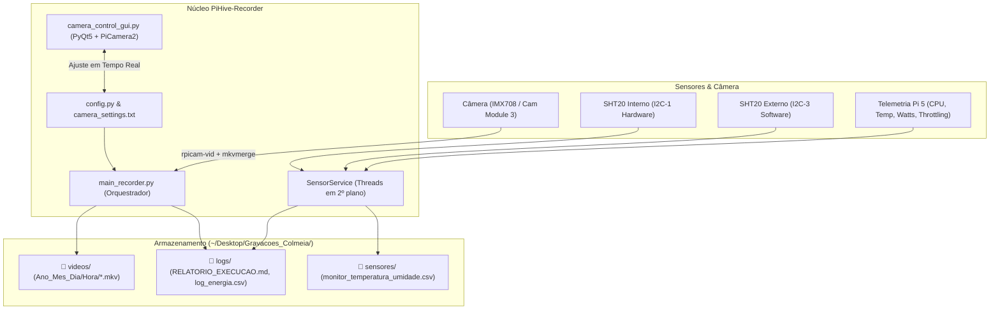

# 🐝 PiHive-Recorder

[](https://www.raspberrypi.com/)
[-blue.svg)](https://www.raspberrypi.com/software/)
[](https://www.python.org/)
[](LICENSE)

**PiHive-Recorder** é um sistema modular e autônomo desenvolvido para monitoramento contínuo de colmeias em Raspberry Pi (otimizado para Raspberry Pi 5). Ele integra **gravação de vídeo em alta velocidade**, **calibração de foco em tempo real com GUI**, **sensores climáticos de temperatura e umidade** e **telemetria elétrica do hardware**.

Projetado para operar em campo de forma resiliente, o sistema conta com **inicialização automática com contagem regressiva** para recuperação pós-queda de energia, salvamento de dados isolado na Área de Trabalho e arquitetura modular de drivers de câmeras e sensores.

---

## 📐 Arquitetura do Sistema



---

## ✨ Principais Funcionalidades

* 📹 **Gravação Automática Segmentada:** Fatiamento de vídeos (padrão 60s) diretamente em H.264 acelerado por hardware e empacotado para MKV via `mkvmerge` preservando taxa de quadros real.
* 🎛️ **Interface Gráfica de Calibração (GUI):** Preview em tempo real com overlay de centralização para ajuste fino de:
  * Posição da lente / Foco manual
  * Velocidade de obturador (Shutter speed em µs)
  * Ganho analógico e Prioridade de Shutter (Auto Gain)
  * Compensação de exposição (EV)
  * Balanço de branco automático (AWB)
  * Modos de resolução (Alta Qualidade 2304x1296@56fps, FHD, HD 1280x720@120fps, High Speed)
* 🌡️ **Monitoramento Climático Multissensor:** Suporte nativo a múltiplos sensores Sensirion SHT20 em barramentos I2C simultâneos (I2C-1 por hardware e I2C-3 por software GPIO).
* ⚡ **Telemetria de Consumo e Hardware:** Estimativa contínua de consumo em Watts (perfis Min/Med/Max para Pi 5), temperatura do SoC, clock de CPU e alertas de throttling por aquecimento ou subtensão via `vcgencmd`.
* 🔄 **Recuperação de Queda de Energia (Autostart Inteligente):** Inicialização automática no boot com contagem regressiva de 60 segundos com janela de cancelamento pelo teclado para permitir ajustes antes de iniciar a gravação.
* 🎯 **Recorte por Hardware (Hardware ROI 736x736 @ 120 FPS):** O ISP de hardware recorta a região de interesse diretamente do fluxo bruto do sensor sem interpolação, sem atraso de scripts e com zero uso adicional de CPU, preservando a densidade total de pixels nativos.
* 📁 **Separação Limpa de Dados:** Todos os vídeos, logs de execução e arquivos CSV são gravados automaticamente na pasta `~/Desktop/Gravacoes_Colmeia/`, mantendo o repositório Git limpo.
* 🧩 **Extensibilidade Modular:** Classes base abstratas (`BaseCamera` e `BaseSensor`) facilitam adicionar suporte a novas câmeras (HQ Camera IMX477, USB V4L2) ou sensores (BME280, DHT22, DS18B20).

---

## 📋 Ambiente Homologado e Compatibilidade

Este projeto foi desenvolvido e exaustivamente validado nas seguintes especificações de sistema e hardware:

| Componente | Especificação Validada | Observações |
|:---|:---|:---|
| **Hardware** | Raspberry Pi 5 (Model B) | Otimizado para Pi 5 (telemetria e perfis de potência) |
| **Sistema Operacional** | Raspberry Pi OS 64-bit (Debian 12 Bookworm) | Kernel Linux `6.12.75+rpt-rpi-2712 aarch64` |
| **Python** | Python 3.11.2 | Recomenda-se Python 3.11.x |
| **Driver de Câmera** | PiCamera2 v0.3.31 + `rpicam-vid` | Pacote nativo `python3-picamera2` |
| **Framework GUI** | PyQt5 v5.15.9 (`PyQt5-sip==12.11.1`) | Aceleração XCB / OpenGL |
| **Barramento I2C** | `smbus2==0.4.2` / `python3-smbus` | Suporte a I2C-1 e I2C-3 software GPIO |
| **Utilitários do Sistema** | `mkvtoolnix` v74.0.0, `i2c-tools` | Empacotamento MKV e barramento I2C |

> [!NOTE]
> Se você estiver utilizando uma versão mais recente do Python (ex: Python 3.12+) ou uma nova versão do Raspberry Pi OS, atente-se às políticas do PEP 668. O instalador automatizado [`install.sh`](file:///home/pi5/Desktop/gravacao_raspberry/install.sh) utiliza `--system-site-packages` para manter a compatibilidade com os drivers binários da placa.
---

## 📷 Modos Oficiais da Câmera (Sony IMX708 / Camera Module 3)

O driver [`cameras/imx708.py`](file:///home/pi5/Desktop/gravacao_raspberry/cameras/imx708.py) implementa os modos nativos do sensor Sony IMX708 e perfis de vídeo otimizados:

| Chave do Modo | Resolução | FPS Máx | Modo Sensor | Descrição e Aplicação |
|:---|:---:|:---:|:---:|:---|
| `FULL_RES` | **4608 x 2592** | ~14 fps | Nativo 0 (Crop Total) | 11.9 MP sem binning. Máxima riqueza de detalhes para fotos e time-lapses. |
| `HIGH_QUALITY` | **2304 x 1296** | ~56 fps | Nativo 1 (2x2 Binning) | Modo padrão Full FOV (campo total). Maior sensibilidade luminosa e nitidez. |
| `FHD_MODE` | **1920 x 1080** | ~56 fps | Escalado ISP (Modo 1) | Padrão Full HD 16:9 compatível com a maioria dos reprodutores de vídeo. |
| `HIGH_SPEED` | **1536 x 864** | ~120 fps | Nativo 2 (2x Crop) | Alta velocidade nativa do sensor para rastrear o voo veloz de abelhas. |
| `HD_MODE` | **1280 x 720** | ~120 fps | Escalado ISP (Modo 2) | HD a 120 FPS. Excelente relação fluidez vs tamanho de arquivo. |
| `HDR_MODE` | **2304 x 1296** | ~30 fps | Nativo 1 (HDR Sensor) | Alto Alcance Dinâmico por hardware no sensor IMX708 para sol direto. |

### 🎯 Recorte por Hardware (ROI 736x736 @ 120 FPS) e Otimização para Microalvos

Para capturar o voo e detectar **cargas corbiculares de pólen (alvos diminutos de 10 a 25 pixels)**, o sistema utiliza uma combinação otimizada de hardware e compressão:

1. **Hardware ROI (`--roi`)**: O processador de sinal de imagem (PiSP) da Raspberry Pi 5 fatia o fluxo bruto do Modo 2 nativo (1536x864) diretamente para **736x736 a 120 FPS** sem interpolação, preservando a máxima densidade ótica sem atraso de processamento na CPU.
2. **Taxa de Bits Calibrada (`8 Mbps`)**: Evita o descarte de altas frequências espaciais e contornos finos das patas da abelha, reduzindo o tamanho dos arquivos em mais de **50%** em relação ao padrão sem perda visual.
3. **H.264 High Profile (`--profile high --level 4.2`)**: Ativa a transformada adaptativa 8x8 DCT e compressão aritmética CABAC, garantindo maior fidelidade de texturas e bordas.
4. **Intervalo Intra (`--intra 60`)**: Injeta um I-frame limpo a cada 0,5s, garantindo que em qualquer aproximação da abelha haverá múltiplos quadros perfeitos para anotação e segmentação de pólen.
5. **Cabeçalhos Inline (`--inline`)**: Força SPS/PPS antes de cada I-frame, permitindo fatiar e processar qualquer trecho do vídeo de forma independente no OpenCV.

#### 💾 Estimativa de Armazenamento e Consumo em Campo

A partir dos testes em bancada a **8 Mbps (736x736 @ 120 FPS)**, temos o seguinte perfil de geração de dados:

| Janela de Tempo | Quantidade de Vídeos | Tamanho Estimado | Observações |
|:---|:---:|:---:|:---|
| **1 Bloco (60 segundos)** | 1 arquivo | **~60 MB** | Fatiamento contínuo em contêiner `.mkv` |
| **1 Hora de Gravação** | 60 arquivos | **~3,6 GB** | Fluxo estável sem picos de CPU |
| **1 Dia de Coleta (15 horas)** | 900 arquivos | **~54,5 GB** | Janela padrão das **04:00 às 19:00** |

##### ⏳ Autonomia Real de Gravação (Descontando SO e Margem de Segurança)

> [!IMPORTANT]
> **Cálculo da capacidade real:** Discos e cartões de memória possuem capacidade formatada útil inferior ao valor nominal. Além disso, o sistema operacional (Raspberry Pi OS 64-bit + pacotes + swap) consome cerca de **12 a 14 GB**, e o `PiHive-Recorder` possui parada automática preventiva configurada para **5.0 GB livres** (`LIMITE_ESPACO_LIVRE_GB` em `config.py`).

| Mídia de Armazenamento | Espaço Bruto Formatado | Desconto (SO + Margem 5GB) | Espaço Útil para Vídeos | Autonomia em Horas Contínuas | Autonomia em Dias de Campo (15h/dia) |
|:---|:---:|:---:|:---:|:---:|:---:|
| **Cartão 128 GB** (microSD / SSD) | ~119 GB | ~19 GB | **~100 GB livres** | **~27 a 28 horas** | **quase 2 dias completos** (~1,8 dia) |
| **Cartão 256 GB** (microSD / SSD) | ~238 GB | ~21 GB | **~217 GB livres** | **~59 a 60 horas** | **4 dias completos de coleta** |

---

## 🔌 Esquema de Ligação do Hardware

### 🌡️ Sensores de Temperatura e Umidade (SHT20)

| Sensor | Barramento | Linha SDA | Linha SCL | Alimentação |
|:---|:---|:---|:---|:---|
| **SHT20 Interno** | **I2C-1 (Hardware)** | Pino 3 (GPIO 2) | Pino 5 (GPIO 3) | 3.3V (Pino 1) e GND (Pino 9) |
| **SHT20 Externo** | **I2C-3 (Software)** | Pino 16 (GPIO 23) | Pino 18 (GPIO 24) | 3.3V (Pino 17) e GND (Pino 25) |

> [!NOTE]
> Para habilitar o barramento I2C-3 por software (bit-banging via GPIO 23/24), adicione a seguinte linha ao final do arquivo `/boot/firmware/config.txt`:
> ```ini
> dtoverlay=i2c-gpio,bus=3,i2c_gpio_sda=23,i2c_gpio_scl=24,i2c_gpio_delay_us=2
> ```
> Após editar, reinicie a Raspberry Pi (`sudo reboot`).

---

## 🚀 Instalação Rápida

Em seu Raspberry Pi, clone o repositório e execute o instalador automatizado:

```bash
git clone git@github.com:MarcosVeniciu/PiHive-Recorder.git
cd PiHive-Recorder
./install.sh
```

### ⚙️ O que o instalador automatizado faz:
1. Instala pacotes do sistema necessários (`mkvtoolnix`, `i2c-tools`, `python3-picamera2`, `python3-pyqt5`, `python3-smbus`, `lxterminal`).
2. Configura o ambiente virtual Python (`.venv`) com permissão aos drivers de hardware da placa (`--system-site-packages`).
3. Adiciona o usuário aos grupos de sistema `video` e `i2c`.
4. Gera dois atalhos clicáveis diretamente na sua **Área de Trabalho**:
   * **`Gravar Vídeos (PiHive)`**
   * **`Ajustar Câmera (PiHive)`**
5. Configura a inicialização automática no boot (**Autostart** em `~/.config/autostart`).

---

## 🎬 Como Usar

### 1. 🎛️ Calibrar a Câmera e Foco
Dê duplo clique no atalho **`Ajustar Câmera (PiHive)`** na Área de Trabalho ou execute no terminal:
```bash
./scripts/ajustar_camera.sh
```
* Ajuste o foco manual até obter a nitidez ideal na colmeia.
* Configure o obturador (Shutter) para congelar o movimento das abelhas.
* Clique em **"Aplicar e Salvar"**. As configurações serão gravadas em `~/Desktop/Gravacoes_Colmeia/camera_settings.txt` (isoladas do Git) e lidas automaticamente pelo gravador.

### 2. 📹 Iniciar a Gravação Automática
Dê duplo clique no atalho **`Gravar Vídeos (PiHive)`** na Área de Trabalho ou execute:
```bash
./scripts/iniciar_gravacao.sh
```
* Uma janela de terminal abrirá exibindo uma contagem regressiva de 60 segundos.
* Se precisar cancelar para mexer na colmeia ou câmera, basta pressionar **`C`** para abrir o menu interativo.
* Ao fim do tempo (ou pressionando `ENTER`), a gravação e a coleta de sensores iniciam imediatamente.

### 3. 🧪 Diagnóstico Rápido de Sensores I2C
Para verificar se ambos os sensores climáticos estão respondendo corretamente:
```bash
python3 tools/teste_sensor.py
```

---

## 📁 Estrutura de Arquivos de Dados

Os dados gerados pelo sistema são salvos na sua Área de Trabalho em `~/Desktop/Gravacoes_Colmeia/`:

```
~/Desktop/Gravacoes_Colmeia/
├── camera_settings.txt                # Calibração ativa da câmera (foco, shutter, ganho, EV)
├── videos/
│   └── 2026_10_21/
│       └── h14/
│           ├── 2026_10_21_h14_M05_S00.mkv
│           └── 2026_10_21_h14_M06_S00.mkv
├── logs/
│   ├── RELATORIO_EXECUCAO.md          # Tabela em Markdown de todos os blocos gravados
│   ├── log_energia_intervalo.csv      # Telemetria periódica (CPU, Temp, Clock, Watts)
│   └── estado_atual.json              # Status instantâneo em tempo real
└── sensores/
    └── monitor_temperatura_umidade.csv  # Leituras dos sensores ambientais
```

---

## ⚙️ Configurações Customizáveis (`config.py`)

No arquivo [`config.py`](file:///home/pi5/Desktop/gravacao_raspberry/config.py), você pode personalizar:

```python
VIDEO_DURATION_SEC = 60          # Duração de cada bloco de vídeo (segundos)
HORA_INICIO_GRAVACAO = 4         # Início do ciclo diário de gravação (04:00)
HORA_TERMINO_GRAVACAO = 19       # Término do ciclo diário de gravação (19:00)
LIMITE_ESPACO_LIVRE_GB = 5.0     # Parada preventiva se disco estiver quase cheio
AUTOSTART_COUNTDOWN_SEC = 60     # Duração da contagem regressiva no boot
CAMERA_DRIVER = "imx708"         # Driver da câmera ativa
```

---

## 🧩 Como Adicionar Novas Câmeras ou Sensores

### 📷 Adicionar uma Nova Câmera
1. Crie um novo arquivo em `cameras/` (ex: `cameras/imx477.py`) herdando de `BaseCamera` ([`cameras/base_camera.py`](file:///home/pi5/Desktop/gravacao_raspberry/cameras/base_camera.py)).
2. Implemente os métodos `build_record_command` e `load_settings`.
3. Registre no arquivo [`cameras/factory.py`](file:///home/pi5/Desktop/gravacao_raspberry/cameras/factory.py) e defina `CAMERA_DRIVER` no `config.py`.

### 🌡️ Adicionar um Novo Sensor
1. Crie um novo driver em `sensors/` (ex: `sensors/bme280.py`) herdando de `BaseSensor` ([`sensors/base_sensor.py`](file:///home/pi5/Desktop/gravacao_raspberry/sensors/base_sensor.py)).
2. Adicione os parâmetros do novo sensor na lista `ACTIVE_SENSORS` em [`config.py`](file:///home/pi5/Desktop/gravacao_raspberry/config.py). O gerenciador cuidará das threads e da escrita das colunas no CSV automaticamente.

---

## 📄 Licença

Este projeto está sob a licença [MIT](LICENSE).
