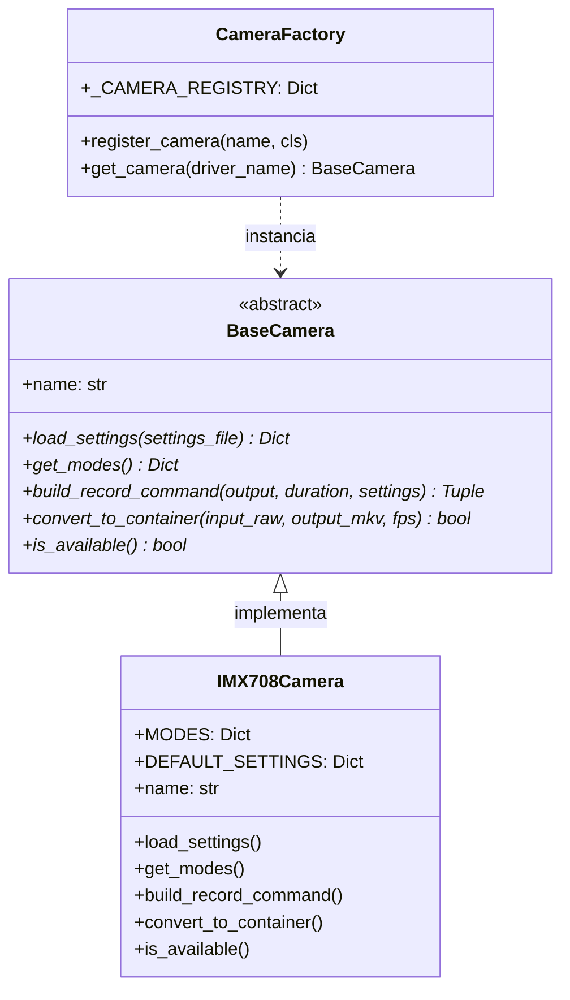

# 📷 Módulo de Câmeras (`cameras/`)

Este diretório gerencia a abstração, configuração e execução dos drivers de câmeras no **PiHive-Recorder**. O sistema adota o padrão de projeto *Factory* aliado a interfaces abstratas, permitindo desacoplar a lógica de gravação do hardware específico de captura.

---

## 🏛️ Arquitetura do Módulo

O módulo é composto pelos seguintes componentes principais:

* [`base_camera.py`](base_camera.py): Classe base abstrata (`BaseCamera`) que define a interface obrigatória para qualquer driver de câmera.
* [`imx708.py`](imx708.py): Driver oficial para a **Raspberry Pi Camera Module 3 (Sony IMX708)**.
* [`factory.py`](factory.py): Fábrica de instâncias (`get_camera`, `register_camera`) responsável por fornecer o driver configurado em [`config.py`](../config.py).



---

## 📷 Câmera Homologada: Sony IMX708 (Camera Module 3)

O driver [`imx708.py`](imx708.py) implementa os modos nativos do sensor Sony IMX708 e perfis de vídeo otimizados para captura biológica em alta velocidade:

### Modos Oficiais e Perfis Suportados

| Chave do Modo | Resolução | FPS Máx | Modo Sensor | Descrição e Aplicação |
|:---|:---:|:---:|:---:|:---|
| `FULL_RES` | **4608 x 2592** | ~14 fps | Nativo 0 (Crop Total) | 11.9 MP sem binning. Máxima riqueza de detalhes para fotos e time-lapses. |
| `HIGH_QUALITY` | **2304 x 1296** | ~56 fps | Nativo 1 (2x2 Binning) | Modo padrão Full FOV (campo total). Maior sensibilidade luminosa e nitidez. |
| `FHD_MODE` | **1920 x 1080** | ~56 fps | Escalado ISP (Modo 1) | Padrão Full HD 16:9 compatível com a maioria dos reprodutores de vídeo. |
| `HIGH_SPEED` | **1536 x 864** | ~120 fps | Nativo 2 (2x Crop) | **(Padrão do Projeto)** Alta velocidade nativa do sensor para rastrear o voo veloz de abelhas. |
| `HD_MODE` | **1280 x 720** | ~120 fps | Escalado ISP (Modo 2) | HD a 120 FPS. Excelente relação fluidez vs tamanho de arquivo. |
| `HDR_MODE` | **2304 x 1296** | ~30 fps | Nativo 1 (HDR Sensor) | Alto Alcance Dinâmico por hardware no sensor IMX708 para sol direto. |

---

### 🎯 Recorte por Hardware (ROI 736x736 @ 120 FPS) e Otimização para Microalvos

Para capturar o voo e detectar **cargas corbiculares de pólen (alvos diminutos de 10 a 25 pixels)**, o sistema utiliza uma combinação otimizada de hardware e compressão:

1. **Hardware ROI (`--roi`)**: O processador de sinal de imagem (PiSP) da Raspberry Pi fatia o fluxo bruto do Modo 2 nativo (1536x864) diretamente para **736x736 a 120 FPS** sem interpolação, preservando a máxima densidade ótica sem atraso de processamento na CPU.
2. **Taxa de Bits Calibrada (`8 Mbps`)**: Evita o descarte de altas frequências espaciais e contornos finos das patas da abelha, reduzindo o tamanho dos arquivos em mais de **50%** em relação ao padrão sem perda visual.
3. **H.264 High Profile (`--profile high --level 4.2`)**: Ativa a transformada adaptativa 8x8 DCT e compressão aritmética CABAC, garantindo maior fidelidade de texturas e bordas.
4. **Intervalo Intra (`--intra 60`)**: Injeta um I-frame limpo a cada 0,5s, garantindo que em qualquer aproximação da abelha haverá múltiplos quadros perfeitos para anotação e segmentação de pólen.
5. **Cabeçalhos Inline (`--inline`)**: Força SPS/PPS antes de cada I-frame, permitindo fatiar e processar qualquer trecho do vídeo de forma independente no OpenCV.
6. **Desativação de Denoise Temporal (`--denoise cdn_off`)**: Impede que o algoritmo de redução de ruído borre ou confunda microalvos em alta velocidade com ruído de sensor.

---

### 💾 Estimativa de Armazenamento e Consumo em Campo

A partir dos testes práticos a **8 Mbps (736x736 @ 120 FPS)**, temos o seguinte perfil de geração de dados:

| Janela de Tempo | Quantidade de Vídeos | Tamanho Estimado | Observações |
|:---|:---:|:---:|:---|
| **1 Bloco (60 segundos)** | 1 arquivo | **~60 MB** | Fatiamento contínuo em contêiner `.mkv` |
| **1 Hora de Gravação** | 60 arquivos | **~3,6 GB** | Fluxo estável sem picos de CPU |
| **1 Dia de Coleta (15 horas)** | 900 arquivos | **~54,5 GB** | Janela padrão das **04:00 às 19:00** |

#### ⏳ Autonomia Real de Gravação (Descontando SO e Margem de Segurança)

> [!IMPORTANT]
> **Cálculo da capacidade real:** Discos e cartões de memória possuem capacidade formatada útil inferior ao valor nominal. Além disso, o sistema operacional (Raspberry Pi OS 64-bit + pacotes + swap) consome cerca de **12 a 14 GB**, e o `PiHive-Recorder` possui parada automática preventiva configurada para **5.0 GB livres** (`LIMITE_ESPACO_LIVRE_GB` em `config.py`).

| Mídia de Armazenamento | Espaço Bruto Formatado | Desconto (SO + Margem 5GB) | Espaço Útil para Vídeos | Autonomia em Horas Contínuas | Autonomia em Dias de Campo (15h/dia) |
|:---|:---:|:---:|:---:|:---:|:---:|
| **Cartão 128 GB** (microSD / SSD) | ~119 GB | ~19 GB | **~100 GB livres** | **~27 a 28 horas** | **quase 2 dias completos** (~1,8 dia) |
| **Cartão 256 GB** (microSD / SSD) | ~238 GB | ~21 GB | **~217 GB livres** | **~59 a 60 horas** | **4 dias completos de coleta** |

---

## 🛠️ Como Adicionar uma Nova Câmera

Para adicionar suporte a um novo sensor (ex: **Raspberry Pi HQ Camera / Sony IMX477**, **Camera Module 2 / Sony IMX219**, **Global Shutter GS Camera / Sony IMX296** ou câmeras **USB V4L2**), siga o passo a passo abaixo:

---

### Passo 1: Criar o Arquivo do Driver em `cameras/`

Crie um novo arquivo (por exemplo, `cameras/imx477.py`) herdando da classe abstrata [`BaseCamera`](base_camera.py).

Implemente todos os métodos e propriedades obrigatórios:

```python
"""
Driver para Raspberry Pi High Quality Camera (Sony IMX477).
"""

import shutil
import subprocess
from pathlib import Path
from typing import Dict, Any, List, Tuple
from cameras.base_camera import BaseCamera


class IMX477Camera(BaseCamera):
    """Implementação para Raspberry Pi HQ Camera (IMX477)."""

    MODES: Dict[str, Dict[str, Any]] = {
        "FULL_RES": {
            "label": "4056x3040 ~10 FPS (Máxima Resolução)",
            "resolution": (4056, 3040),
            "fps": 10,
        },
        "FHD_MODE": {
            "label": "1920x1080 ~60 FPS (Full HD 1080p)",
            "resolution": (1920, 1080),
            "fps": 60,
        },
        "HIGH_SPEED": {
            "label": "1332x990 ~120 FPS (Alta Velocidade)",
            "resolution": (1332, 990),
            "fps": 120,
        },
    }

    DEFAULT_SETTINGS: Dict[str, Any] = {
        "MODE": "HIGH_SPEED",
        "SHUTTER_SPEED": 5000,
        "ANALOGUE_GAIN": 4.0,
        "AWB_ENABLE": True,
        "AUTO_GAIN": False,
        "EXPOSURE_VALUE": 0.0,
        "VIDEO_BITRATE": 8000000,
        "VIDEO_INTRA": 60,
    }

    @property
    def name(self) -> str:
        """Nome identificador do driver."""
        return "imx477"

    def get_modes(self) -> Dict[str, Dict[str, Any]]:
        """Retorna os modos suportados pelo sensor."""
        return self.MODES

    def load_settings(self, settings_file: Path) -> Dict[str, Any]:
        """Carrega configurações do arquivo .txt ou aplica padrões."""
        settings = self.DEFAULT_SETTINGS.copy()
        if settings_file.exists():
            with open(settings_file, "r", encoding="utf-8") as f:
                for line in f:
                    if ":" in line:
                        k, v = line.strip().split(":", 1)
                        k, v = k.strip(), v.strip()
                        if k in settings:
                            # Converta tipos adequados (int, float, bool)
                            if k in ("SHUTTER_SPEED", "VIDEO_BITRATE", "VIDEO_INTRA"):
                                settings[k] = int(float(v))
                            elif k in ("ANALOGUE_GAIN", "EXPOSURE_VALUE"):
                                settings[k] = float(v)
                            elif k in ("AWB_ENABLE", "AUTO_GAIN"):
                                settings[k] = (v.lower() == "true")
                            else:
                                settings[k] = v
        return settings

    def build_record_command(
        self,
        output_h264: str,
        duration_ms: int,
        settings: Dict[str, Any]
    ) -> Tuple[List[str], int]:
        """Gera o comando de linha de comando para gravação via rpicam-vid."""
        mode_key = settings.get("MODE", "HIGH_SPEED")
        mode_info = self.MODES.get(mode_key, self.MODES["HIGH_SPEED"])
        width, height = mode_info["resolution"]
        fps = mode_info["fps"]

        cmd = [
            "rpicam-vid",
            "-o", str(output_h264),
            "-t", str(duration_ms),
            "--width", str(width),
            "--height", str(height),
            "--framerate", str(fps),
            "--bitrate", str(settings.get("VIDEO_BITRATE", 8000000)),
            "--profile", "high",
            "--level", "4.2",
            "--intra", str(settings.get("VIDEO_INTRA", 60)),
            "--inline",
            "--nopreview",
            "--shutter", str(settings.get("SHUTTER_SPEED", 5000)),
        ]

        if settings.get("AUTO_GAIN", False):
            cmd.extend(["--ev", str(settings.get("EXPOSURE_VALUE", 0.0))])
        else:
            cmd.extend(["--gain", str(settings.get("ANALOGUE_GAIN", 4.0))])

        if settings.get("AWB_ENABLE", True):
            cmd.extend(["--awb", "auto"])
        else:
            cmd.extend(["--awbgains", "1.0,1.0"])

        return cmd, fps

    def convert_to_container(self, input_h264: str, output_mkv: str, fps: int) -> bool:
        """Empacota o stream H.264 para MKV via mkvmerge com o framerate correto."""
        cmd = [
            "mkvmerge",
            "-o", str(output_mkv),
            "--default-duration", f"0:{fps}fps",
            str(input_h264),
        ]
        res = subprocess.run(cmd, stdout=subprocess.DEVNULL, stderr=subprocess.PIPE, text=True)
        return res.returncode == 0

    def is_available(self) -> bool:
        """Verifica se ferramentas necessárias existem no sistema operacional."""
        return shutil.which("rpicam-vid") is not None and shutil.which("mkvmerge") is not None
```

---

### Passo 2: Registrar a Câmera na Fábrica (`cameras/factory.py`)

Abra o arquivo [`cameras/factory.py`](factory.py) e registre o novo driver no dicionário `_CAMERA_REGISTRY`:

```python
from cameras.base_camera import BaseCamera
from cameras.imx708 import IMX708Camera
from cameras.imx477 import IMX477Camera  # <-- 1. Importar a nova classe

_CAMERA_REGISTRY: Dict[str, Type[BaseCamera]] = {
    "imx708": IMX708Camera,
    "camera_module_3": IMX708Camera,
    "imx477": IMX477Camera,              # <-- 2. Adicionar ao registro
    "hq_camera": IMX477Camera,
}
```

---

### Passo 3: Ativar o Driver no Arquivo Global de Configuração

Edite o arquivo [`config.py`](../config.py) na raiz do projeto para apontar para o novo identificador:

```python
# --- SELEÇÃO DE CÂMERA ---
CAMERA_DRIVER = "imx477"  # ou "imx708"
```

A partir desse momento, quando o gravador [`main_recorder.py`](../main_recorder.py) for iniciado, ele carregará automaticamente a classe registrada para o `imx477`.

---

### Passo 4: (Opcional) Ajustar a Interface Gráfica de Calibração (GUI)

Se a nova câmera possuir recursos específicos (como lentes manuais sem atuador VCA de foco automático, ausência de HDR por sensor ou resoluções distintas), adapte a lista `CAMERA_MODES` em [`gui/camera_control_gui.py`](../gui/camera_control_gui.py) para refletir os modos da câmera selecionada.
