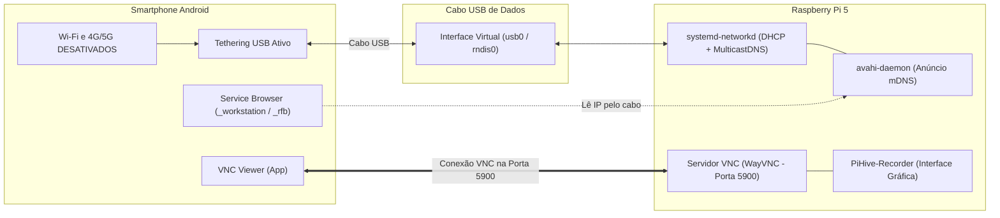
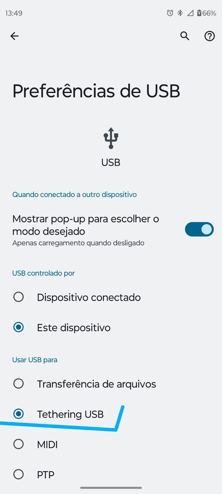
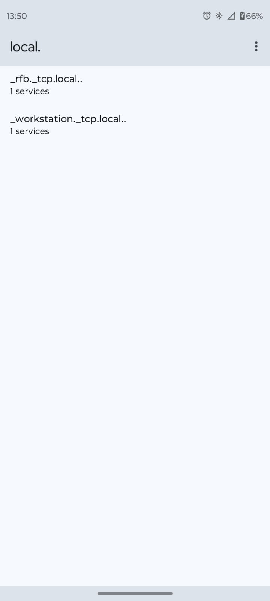
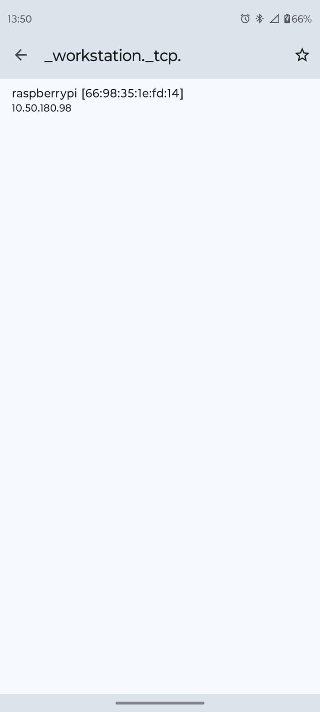
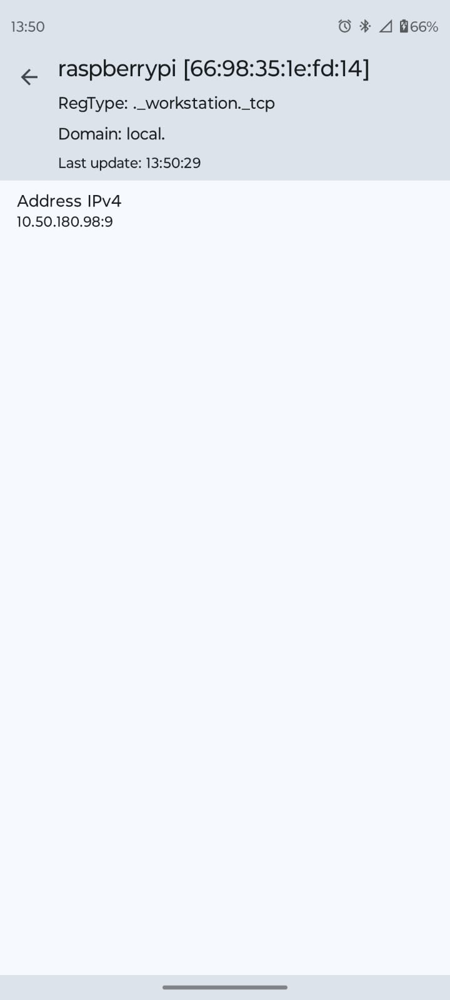
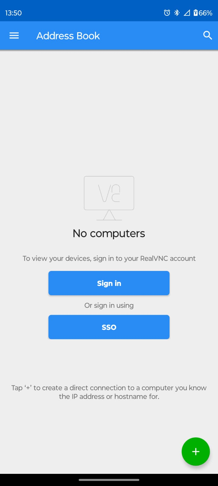
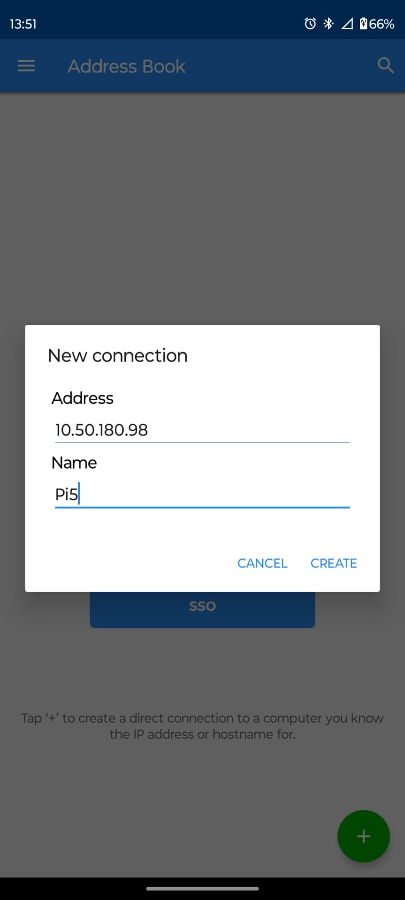
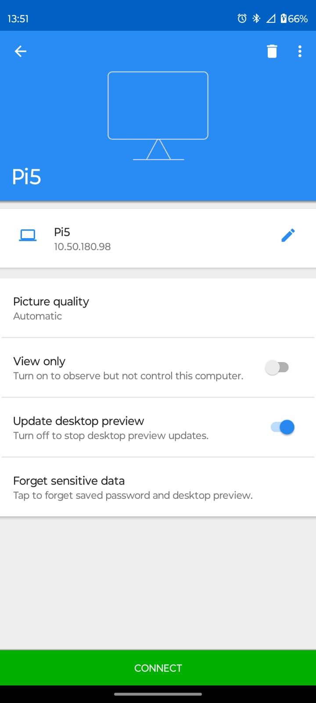
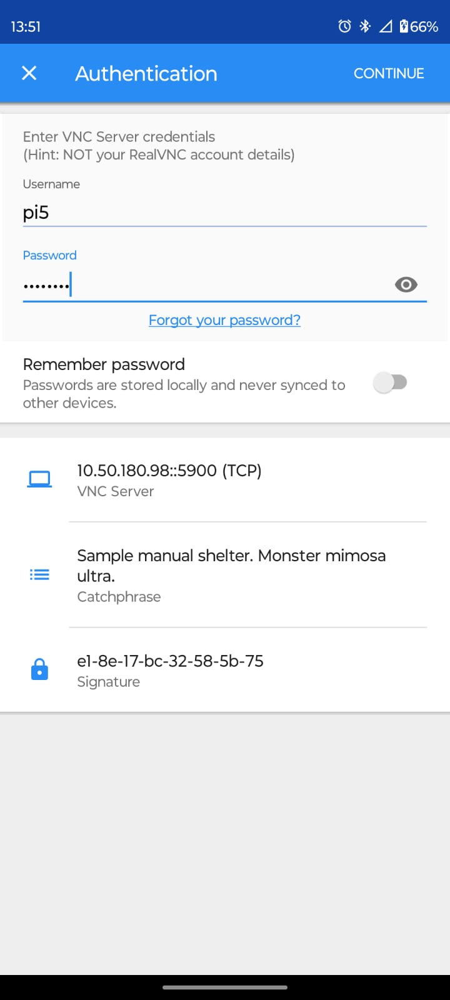
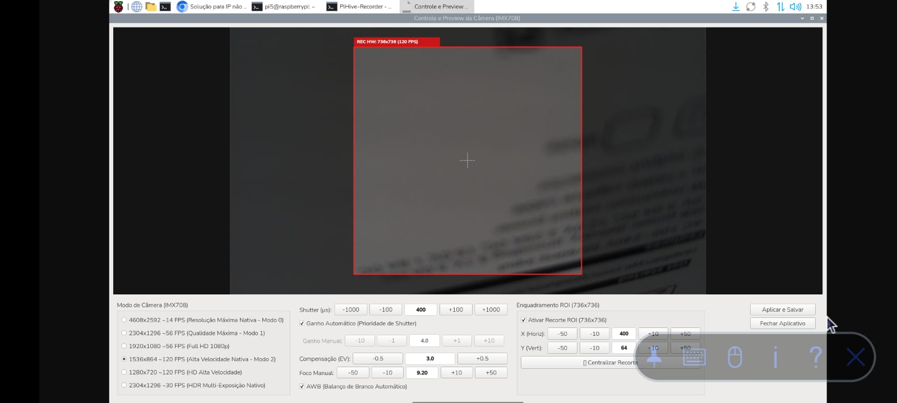

# 📱 Guia de Operação Headless: Raspberry Pi 5 com USB Tethering & VNC

**Objetivo:** Operar o **Raspberry Pi 5** em campo de forma 100% *headless* (sem monitor, teclado ou mouse dedicados), utilizando um smartphone Android como:
1. **Ponto de Acesso de Rede Local:** Conexão de dados direta via cabo USB (*USB Tethering*).
2. **Monitor e Teclado Sensível ao Toque:** Controle remoto em tempo real via **VNC Viewer**.
3. **Localizador Automático de IP:** Descoberta de serviços mDNS/Bonjour via **Service Browser** (sem adivinhação de IP).

---

## 🧭 Visão Geral da Arquitetura



---

## 🛠️ Parte 1: Configuração Única (A ser feita no Raspberry Pi)

Esta etapa precisa ser executada apenas **uma única vez** com o Raspberry Pi conectado a uma tela ou via terminal antes de ir a campo.

### 1.1. Execução do Script Automatizado

Crie ou atualize o script `setup_tethering.sh` no diretório do projeto:

```bash
cd ~/Desktop/PiHive-Recorder/tethering
chmod +x setup_tethering.sh
sudo ./setup_tethering.sh
```

#### O que o script configura automaticamente:
1. **Configuração de Rede USB (`/etc/systemd/network/10-usb-tethering.network`):**
   * Habilita DHCP automático para as interfaces `wwan*`, `usb*` e `rndis*`.
   * Ativa a diretiva `MulticastDNS=yes`, permitindo que o Android e o Pi troquem anúncios mDNS pela conexão USB.
2. **Instalação e Publicação do Serviço mDNS (Avahi):**
   * Instala o pacote `avahi-daemon` via repositórios do sistema.
   * Cria o descritor `/etc/avahi/services/vnc.service`, anunciando o tipo `_rfb._tcp` na porta padrão `5900`.
3. **Habilitação Silenciosa do VNC:**
   * Ativa o servidor WayVNC através do comando `raspi-config nonint do_vnc 0`.
4. **Otimizações de Boot Rápido (Sem Travamentos em Campo):**
   * Mascara os serviços `systemd-networkd-wait-online` e `NetworkManager-wait-online`. Com isso, a placa inicializa em menos de 30 segundos, sem travar aguardando internet.

---

### 1.2. Comandos para Verificar se a Configuração Funcionou no Raspberry Pi

Com o celular conectado e o **Tethering USB** ativado, execute os comandos abaixo no terminal da Raspberry Pi para atestar que todos os componentes subiram corretamente:

#### A. Checar se a placa recebeu o IP do Smartphone
```bash
hostname -I
```
* **Saída esperada:** Exibe o IP atribuído pelo celular (ex: `10.50.180.98` ou `10.50.180.99`).

#### B. Checar a interface USB e driver ativo
```bash
ip -br a
```
* **Saída esperada:** A interface `usb0` (ou `rndis0`) deve estar listada com o status `UP` ou `UNKNOWN` acompanhada da sub-rede atribuída (ex: `10.50.180.98/24`).

#### C. Inspecionar o status no gerenciador de rede
```bash
networkctl status usb0
```
* **Saída esperada:**
  * `State: routable (configured)`
  * `Driver: rndis_host`
  * `Model: (Modelo do seu smartphone, ex: moto_g52)`
  * `Gateway: IP_do_celular (ex: 10.50.180.29)`

#### D. Confirmar se o serviço de descoberta (Avahi) está rodando
```bash
sudo systemctl status avahi-daemon
```
* **Saída esperada:** `Active: active (running)`.

#### E. Verificar se o servidor VNC está escutando conexões
```bash
ss -tulpn | grep 5900
```
* **Saída esperada:** Registro de processo escutando na porta `*:5900`.

---

## 📲 Parte 2: Processo de Conexão Diária (A Rotina em Campo)

Siga este passo a passo sempre que for operar o Raspberry Pi em campo utilizando apenas o smartphone Android.

### 2.1. Aplicativos Necessários no Smartphone (Instalar previamente)

Instale os dois aplicativos essenciais pela Google Play Store:
* **Service Browser (Descoberta mDNS/Bonjour):** [Download do Service Browser](https://play.google.com/store/apps/details?id=com.druk.servicebrowser&hl=pt_BR&pli=1)
* **VNC Viewer (Visualizador e Controle de Área de Trabalho):** [Download do VNC Viewer](https://play.google.com/store/apps/details?id=org.termuxstudio.vncviewer)

---

### 2.2. Conexão Física e Configuração Crítica no Celular

1. Ligue a alimentação do Raspberry Pi 5.
2. Conecte o smartphone à porta USB da Raspberry Pi usando um **cabo USB de dados**.
3. **⚠️ PASSO FUNDAMENTAL (REGRA DE OURO):**
   * **Desative temporariamente o Wi-Fi e os Dados Móveis (4G/5G)** no celular.
   * *Motivo:* Por padrão, o Android tenta direcionar as buscas de rede multicast para a conexão Wi-Fi ou dados móveis. Ao desligá-los, o sistema força todo o tráfego mDNS exclusivamente pelo cabo USB.
4. No celular, acesse a notificação de conexão USB ou vá em:
   * **Configurações > Preferências de USB** e selecione **Tethering USB** (Vínculo USB).



---

### 2.3. Descoberta Automática do IP pelo Service Browser

1. Abra o aplicativo **Service Browser** no smartphone.
2. Na lista de domínios sob `local.`, localize o serviço **`_workstation._tcp.local..`** ou **`_rfb._tcp.local..`**:



3. Toque no item correspondente ao seu Raspberry Pi (ex: `raspberrypi [66:98:35:1e:fd:14]`):



4. O endereço IP fornecido pelo smartphone à placa será exibido no campo **Address IPv4** (neste exemplo: `10.50.180.98`):



---

### 2.4. Conexão e Controle Remoto via VNC Viewer

1. Abra o aplicativo **VNC Viewer** no smartphone.
2. Toque no botão redondo **`+`** verde no canto inferior direito para adicionar uma nova conexão:



3. Preencha os campos da conexão:
   * **Address:** Digite o IP descoberto no Service Browser (ex: `10.50.180.98`).
   * **Name:** Dê um nome para identificar a placa (ex: `Pi5`).
   * Toque em **CREATE**:



4. Na página de detalhes da conexão criada, toque no botão verde inferior **CONNECT**:



5. Na tela de autenticação (**Authentication**):
   * **Username:** Usuário da placa (padrão: `pi5`).
   * **Password:** Senha cadastrada no Raspberry Pi OS.
   * Toque em **CONTINUE**:



6. **Pronto!** A área de trabalho completa da Raspberry Pi 5 será exibida na tela do celular com total sensibilidade ao toque, permitindo ajustar a câmera, disparar gravações e acompanhar os scripts de campo em tempo real:



---

## 💡 Resumo Rápido para o Operador em Campo

| Etapa | Ação | Verificação de Sucesso |
| :--- | :--- | :--- |
| **1. Conectar** | Ligar o Pi e plugar o cabo USB no celular. | LED do Pi aceso e celular indicando carregamento. |
| **2. Isolar Rede** | Desligar Wi-Fi e 4G/5G do celular. | Apenas o ícone de Tethering USB ativo na barra superior. |
| **3. Ativar Vínculo** | Marcar "Tethering USB" nas configurações do Android. | Notificação "Compartilhamento de conexão USB ativo". |
| **4. Achar IP** | Abrir o *Service Browser* e ver o IP sob `_workstation._tcp`. | IP visível (ex: `10.50.180.98`). |
| **5. Operar** | Abrir o *VNC Viewer* e tocar em *CONNECT*. | Desktop e interface do PiHive-Recorder no visor. |