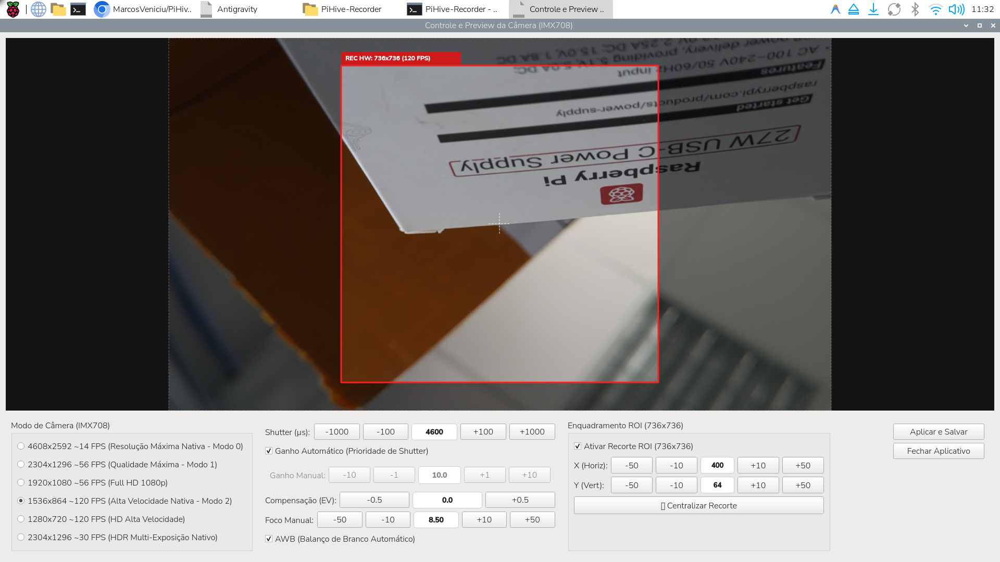

# 🎛️ Interface Gráfica de Calibração da Câmera (GUI)

Este diretório contém a interface gráfica de calibração em tempo real do **PiHive-Recorder**, desenvolvida em **PyQt5** e integrada com a biblioteca oficial **PiCamera2**.

A interface foi projetada especificamente para o módulo **Raspberry Pi Camera Module 3 (Sensor Sony IMX708)**, permitindo calibrar o enquadramento, foco ótico macro, velocidade de obturador para congelar o movimento das abelhas, compensação de exposição e recorte de área de interesse (ROI) antes de iniciar as gravações em campo.

---

## 🖥️ Visão Geral da Interface

Abaixo está a interface em execução, ilustrando o preview do sensor com o demarcador de recorte e todos os controles de ajuste:



---

## 🚀 Como Iniciar a Interface

Você pode abrir a interface de calibração de duas maneiras:

1. **Pela Área de Trabalho**: Dê um duplo clique no atalho **"Ajustar Câmera"**.
2. **Pelo Terminal**:
   ```bash
   cd ~/Desktop/PiHive-Recorder
   ./scripts/ajustar_camera.sh
   ```

> [!IMPORTANT]
> Apenas um processo pode acessar a câmera por vez. Antes de abrir a interface, certifique-se de que a gravação em segundo plano não está em execução. Da mesma forma, feche a interface antes de disparar o script de gravação autônoma.

---

## 🧭 Componentes da Interface

A interface é dividida em **duas áreas principais**: o **Monitor de Vídeo Superior (com Guia de Enquadramento)** e o **Painel de Controles Inferior**.

---

### 1. Monitor de Vídeo e Guias de Enquadramento (Overlay Flutuante)

O monitor superior renderiza o fluxo contínuo do sensor acelerado por OpenGL via `QGlPicamera2`. Sobreposto a ele há um visor transparente dinâmico:

* **Caixa Vermelha (`REC HW: 736x736`):** Delimita a região exata que será recortada diretamente pelo hardware e gravada nos vídeos.
* **Máscara Escurecida:** A área fora do recorte é sombreada para ajudar o operador a focar a atenção na região útil de gravação.
* **Mira Central Suave (`+`):** Marca o ponto central exato do recorte, ideal para alinhar o alvado (entrada da colmeia) ou a rampa de pouso.
* **Modo Padrão (Sem ROI):** Caso o recorte esteja desligado, a interface exibe uma linha central tracejada dividindo o lado esquerdo e direito da cena.

---

### 2. Modos de Câmera (IMX708) — Coluna Esquerda

Permite alternar entre as resoluções e taxas de quadros nativas suportadas pelo sensor Sony IMX708:

| Modo na Interface | Resolução | Taxa Máx. (FPS) | Aplicação Recomendada |
| :--- | :---: | :---: | :--- |
| **`4608x2592 ~14 FPS`** | $4608 \times 2592$ | ~14 FPS | Resolução máxima nativa (11.9 MP). Ideal para fotografias estáticas de alta fidelidade e time-lapses. |
| **`2304x1296 ~56 FPS`** | $2304 \times 1296$ | ~56 FPS | Modo padrão Full FOV (campo de visão completo) com *2x2 binning*. Máxima sensibilidade de luz e nitidez. |
| **`1920x1080 ~56 FPS`** | $1920 \times 1080$ | ~56 FPS | Padrão Full HD 16:9 escalado pelo processador de imagem (ISP). Compatibilidade ampla de vídeo. |
| **`1536x864 ~120 FPS`** | $1536 \times 864$ | ~120 FPS | **(Recomendado para o projeto)** Modo nativo de alta velocidade com *2x crop*. Permite congelar o bater de asas e o voo rápido das abelhas. |
| **`1280x720 ~120 FPS`** | $1280 \times 720$ | ~120 FPS | Modo HD escalado a 120 FPS. Reduz o tamanho final dos arquivos de vídeo. |
| **`2304x1296 ~30 FPS`** | $2304 \times 1296$ | ~30 FPS | Modo HDR multi-exposição nativo do sensor. Indicado para cenas sob luz solar direta extrema com sombras fortes. |

---

### 3. Controles de Exposição, Ganho, EV e Foco — Coluna Central

Esta seção concentra os parâmetros fotográficos essenciais para a qualidade da imagem:

#### ⚡ Shutter (µs) — Velocidade do Obturador
* **O que faz:** Controla o tempo de exposição em microssegundos ($\mu\text{s}$). Exemplo: $4600\,\mu\text{s} \approx 1/217\,\text{s}$; $1000\,\mu\text{s} = 1/1000\,\text{s}$; $400\,\mu\text{s} = 1/2500\,\text{s}$.
* **Como usar:** 
  * Use os botões `[-1000]`, `[-100]`, `[+100]`, `[+1000]` para navegar.
  * Para rastreamento de abelhas e detecção de pólen corbicular, recomenda-se tempos entre **$400\,\mu\text{s}$ e $4600\,\mu\text{s}$** para evitar borrão de movimento (*motion blur*).

#### 🎚️ Ganho Automático (Prioridade de Shutter) & Ganho Manual
* **Ganho Automático marcado (`AUTO_GAIN = True`):**
  * O tempo de **Shutter fica rigidamente fixo** no valor escolhido para manter a nitidez dos alvos móveis.
  * A câmera ajusta dinamicamente apenas o ganho do sensor (*ISO/Gain*) para se adaptar a mudanças graduais de luminosidade (nuvens, sombras, pôr do sol).
  * O campo **Ganho Manual** fica desabilitado (esmaecido).
* **Ganho Automático desmarcado (`AUTO_GAIN = False`):**
  * O modo manual total é ativado.
  * Você define diretamente o ganho analógico nos botões `[-10]`, `[-1]`, `[+1]`, `[+10]`. Valores variam de `1.0` (sem amplificação) até `16.0` (máxima amplificação do sensor).

#### ☀️ Compensação (EV) — *Exposure Value*
* **O que faz:** Ajusta o brilho alvo do algoritmo quando o **Ganho Automático** está ativo.
  * **Valores Positivos (`+0.5`, `+1.0`, etc.):** Forçam a cena a ficar mais **clara**.
  * **Valores Negativos (`-0.5`, `-1.0`, etc.):** Forçam a cena a ficar mais **escura**.
  * **Neutro (`0.0`):** Utiliza a medição de exposição padrão do sensor.
* **Dica de uso:** Se a entrada da colmeia estiver em sombra profunda contra uma parede ensolarada, aumente o EV para revelar detalhes das abelhas. Se o fundo branco estiver estourando, diminua o EV.

> [!NOTE]
> Com um Shutter muito rápido (ex: $400\,\mu\text{s}$) em ambientes internos ou com pouca luz, valores muito altos de EV não conseguirão clarear além do limite físico máximo do sensor (ganho analógico máximo de ~16x).

#### 🔍 Foco Manual (Posição da Lente)
* **O que faz:** Controla o atuador de bobina móvel (VCA) do Camera Module 3 para posicionar a lente com precisão milimétrica.
* **Valores:**
  * `0.00`: Foco no infinito (objetos distantes).
  * `5.00` a `10.00`+: Faixa macro para objetos a poucos centímetros da lente (entrada da colmeia).
* **Como calibrar:** Aproxime a câmera da rampa de pouso ou do túnel e clique nos botões `[-50]`, `[-10]`, `[+10]`, `[+50]` observando a nitidez de superfícies com textura fina (como pelos das abelhas ou ranhuras da madeira).

#### 🎨 AWB (Balanço de Branco Automático)
* **Marcado:** O sensor equilibra as cores continuamente conforme a temperatura da luz do sol ou lâmpadas.
* **Desmarcado:** Fixa os ganhos de cor em $(1.0, 1.0)$, garantindo consistência estrita de matiz para análises colorimétricas de pólen.

---

### 4. Enquadramento ROI (736x736) — Coluna Direita

O **Hardware ROI (Region of Interest)** utiliza o processador de imagem (ISP) nativo do Raspberry Pi para extrair uma janela de $736 \times 736$ pixels sem interpolação, sem atraso de processamento e sem consumo de CPU.

* **Checkbox `Ativar Recorte ROI (736x736)`**: Ativa ou desativa a gravação recortada.
* **Controles `X (Horiz)` e `Y (Vert)`**:
  * Use os botões `[-50]`, `[-10]`, `[+10]`, `[+50]` para posicionar o quadro exatamente sobre a entrada ou rampa de pouso.
  * O visor atualiza as coordenadas em tempo real no preview.
* **Botão `🎯 Centralizar Recorte`**: Centraliza instantaneamente o quadrado $736 \times 736$ no meio do sensor.

> [!TIP]
> O formato $736 \times 736$ a 120 FPS é a proporção ideal para alimentar redes neurais de detecção de objetos (YOLO, MobileNet) voltadas à contagem e classificação de abelhas e cargas de pólen.

---

### 5. Botões de Ação

* **`Aplicar e Salvar`**:
  * Aplica as alterações no sensor de imediato.
  * Grava os parâmetros no arquivo `camera_settings.txt` (localizado na raiz do projeto). Esses são os parâmetros exatos que o gravador autônomo [`main_recorder.py`](../main_recorder.py) utilizará.
* **`Fechar Aplicativo`**:
  * Encerra o preview, desliga o sensor com segurança e libera o dispositivo para que os scripts de gravação possam operar.

---

## 📋 Passo a Passo Recomendado para Calibração em Campo

1. **Fixar a Câmera:** Posicione o Raspberry Pi e o módulo de câmera apontados para a entrada da colmeia.
2. **Abrir a Interface:** Execute o atalho **"Ajustar Câmera"**.
3. **Selecionar o Modo:** Escolha `1536x864 ~120 FPS (Alta Velocidade Nativa - Modo 2)`.
4. **Posicionar o Recorte (ROI):**
   * Ative o recorte $736 \times 736$.
   * Ajuste o eixo **X** e o eixo **Y** para enquadrar a rampa de pouso ou o orifício de entrada da colmeia.
5. **Calibrar o Foco:** Ajuste o **Foco Manual** até que a textura da madeira da entrada ou abelhas em repouso fiquem perfeitamente nítidas.
6. **Ajustar a Velocidade do Shutter e EV:**
   * Mantenha **Ganho Automático** marcado.
   * Defina o **Shutter** entre $1000\,\mu\text{s}$ e $4600\,\mu\text{s}$ conforme a luz ambiente disponível.
   * Se a área interna estiver muito escura, suba a **Compensação (EV)** em `+0.5` ou `+1.0`.
7. **Salvar:** Clique em **`Aplicar e Salvar`**.
8. **Fechar:** Clique em **`Fechar Aplicativo`** para liberar a câmera para o gravador automático.
