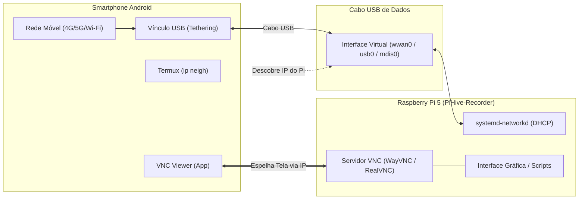

# 📱 Conexão e Controle Remoto via USB Tethering & VNC

Este diretório contém o script de automação e o guia prático para operar o **Raspberry Pi 5** em modo **Headless** (sem monitor, teclado ou mouse externos), utilizando um smartphone **Android** como:
1. **Provedor de Internet:** Compartilhamento de dados móveis via cabo USB (*USB Tethering*).
2. **Monitor e Teclado Remoto:** Espelhamento da interface gráfica em tempo real via **VNC Viewer**.

---

## 🧭 Visão Geral da Arquitetura



---

## 🛠️ Parte 1: Configuração Única (No Raspberry Pi)

Você só precisa executar esta etapa **uma única vez**. O script automatiza a configuração de rede, ativa o servidor VNC e elimina timeouts de espera por conexão que atrasariam a inicialização do Pi em campo.

### Executando o Script Automatizado:

No terminal do Raspberry Pi, entre na pasta e execute com permissão de superusuário:

```bash
cd ~/Desktop/PiHive-Recorder/tethering
sudo ./setup_tethering.sh
```

### O que o script realiza automaticamente:

1. **Ativação de USB Tethering Universal (`/etc/systemd/network/10-usb-tethering.network`):**
   * Configura suporte automático a DHCP com máscara `wwan* usb* rndis*`. Isso garante compatibilidade imediata com qualquer marca de smartphone Android (Samsung, Motorola, Xiaomi, etc.).
2. **Habilitação Silenciosa do VNC:**
   * Executa `raspi-config nonint do_vnc 0` para ligar o servidor de desktop remoto sem menus interativos.
3. **Otimização de Tempo de Boot (Sem Travamentos):**
   * Mascara os serviços `systemd-networkd-wait-online` e `NetworkManager-wait-online`. Com isso, se o Pi for ligado em campo sem internet conectada, ele **não ficará travado esperando conexão por 2 minutos**, iniciando imediatamente.
   * Desativa o `cloud-init` e a busca automática de firmware no boot (`rpi-eeprom-update`).
4. **Validação da Câmera:**
   * Verifica a presença do parâmetro `camera_auto_detect=1` no arquivo `/boot/firmware/config.txt`.

Após o término da execução, reinicie o Raspberry Pi:
```bash
sudo reboot
```

---

## 📲 Parte 2: Processo de Conexão Diária (Rotina de Campo)

Siga este procedimento sempre que for operar o Raspberry Pi em campo com o celular:

### 2.1. Aplicativos Necessários no Smartphone Android (Instalar uma vez)

* **[VNC Viewer](https://play.google.com/store/apps/details?id=com.realvnc.viewer.android):** Para visualizar e controlar a tela do Raspberry Pi.
* **[Termux](https://play.google.com/store/apps/details?id=com.termux) (ou F-Droid):** Terminal Linux no Android para descobrir o endereço IP do Raspberry Pi.

---

### 2.2. Conexão do Hardware e Ativação

1. Ligue o Raspberry Pi 5 na sua fonte ou bateria de campo.
2. Conecte o smartphone à porta USB do Raspberry Pi usando um **cabo USB de boa qualidade (que suporte dados)**.
3. No smartphone Android, acesse:
   * **Configurações** > **Rede e Internet** (ou **Conexões**) > **Ponto de Acesso e Tethering** > Ative **Vínculo USB (USB Tethering)**.

---

### 2.3. Descobrir o Endereço IP do Raspberry Pi

Como o smartphone Android atua como roteador da conexão USB, ele atribui dinamicamente um endereço IP ao Raspberry Pi via DHCP. Para descobrir esse IP:

1. Abra o aplicativo **Termux** no celular.
2. Digite o seguinte comando e aperte **Enter**:
   ```bash
   ip neigh
   ```
3. A saída será semelhante a esta:
   ```text
   10.109.36.35 dev rndis0 lladdr dc:a6:32:ab:cd:ef REACHABLE
   ```
   * O primeiro número da linha (`10.109.36.35`, neste exemplo) é o **endereço IP do Raspberry Pi**.
   * *(Caso o comando não retorne nada de imediato, digite `arp -a` ou aguarde alguns segundos até a interface estabelecer a conexão).*

---

### 2.4. Acessar a Área de Trabalho via VNC Viewer

1. Abra o aplicativo **VNC Viewer** no smartphone.
2. Toque no botão **`+`** para cadastrar uma nova conexão:
   * **Address:** Cole o endereço IP obtido no Termux (ex: `10.109.36.35`).
   * **Name:** Dê um nome para identificar a placa (ex: `PiHive 5`).
3. Toque na conexão recém-criada e confirme a chave de segurança.
4. Digite as credenciais do seu Raspberry Pi:
   * **Username:** Usuário da placa (padrão: `pi5` ou o configurado na instalação).
   * **Password:** Senha da sua conta.
5. **Pronto!** A Área de Trabalho completa do Raspberry Pi 5 aparecerá no visor do seu celular com controle total de mouse e teclado por toque.

---

## 🔍 Resolução de Problemas (Troubleshooting)

| Sintoma | Causa Mais Comum | Ação Corretiva |
| :--- | :--- | :--- |
| **`ip neigh` não exibe nenhum dispositivo** | Cabo USB é apenas de carregamento (sem linhas de dados). | Troque por um cabo USB homologado para transferência de dados. |
| **Opção Vínculo USB esmaecida no Android** | O smartphone não reconheceu a conexão física com o Pi. | Reconecte o cabo USB e certifique-se de que a porta USB do Pi está alimentada. |
| **VNC Viewer dá erro de conexão recusada** | O servidor VNC não inicializou ou o IP mudou. | Verifique se o IP no Termux mudou após reconectar o cabo. Execute `sudo raspi-config nonint do_vnc 0` no Pi se necessário. |
| **A tela do VNC fica preta** | Resolução virtual não definida para modo headless. | No Pi, configure uma resolução de tela padrão em `raspi-config` > *Display Options* > *VNC Resolution* (ex: 1920x1080). |
