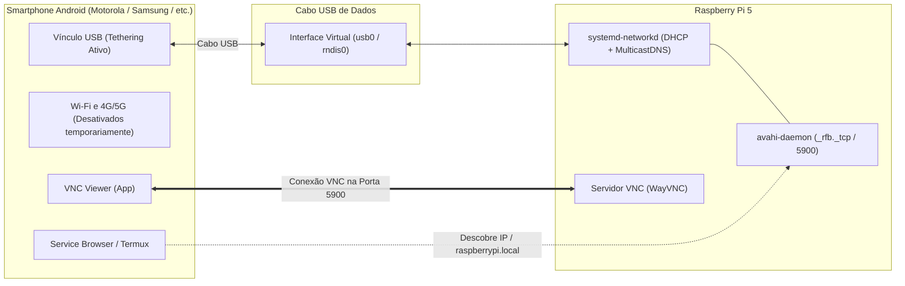

# 📱 Conexão e Controle Remoto via USB Tethering & VNC (Headless)

Este diretório contém a automação de rede e o guia operacional para controlar o **Raspberry Pi 5** sem necessidade de monitor, teclado ou mouse externos, usando um smartphone **Android** como tela sensível ao toque (via VNC Viewer) e provedor de rede local cabeada via USB Tethering.

> [!TIP]
> **Guia Passo a Passo Ilustrado com Capturas de Tela:**
> Para acompanhar o tutorial visual com capturas reais de cada etapa no smartphone Android (Service Browser, VNC e tela do sistema), consulte o [Guia Ilustrado de Operação Headless](../doc/raspberry_pi_5_usb_tethering.md).

---

## 🧭 Visão Geral da Arquitetura



---

## 🛠️ Parte 1: Configuração Única (No Raspberry Pi)

Execute esta etapa apenas uma vez no terminal do Raspberry Pi:

```bash
cd ~/Desktop/PiHive-Recorder/tethering
chmod +x setup_tethering.sh
sudo ./setup_tethering.sh
```

Após o término da execução, reinicie o sistema:

```bash
sudo reboot
```

### O que o script realiza automaticamente:

1. **Configuração da interface USB (`10-usb-tethering.network`):** Configura DHCP automático e ativa suporte a `MulticastDNS=yes` para interfaces `wwan*`, `usb*` e `rndis*`.
2. **Descoberta de Serviço mDNS (Avahi):** Instala o `avahi-daemon` e cria o arquivo de serviço `/etc/avahi/services/vnc.service`, anunciando o servidor VNC (`_rfb._tcp` na porta `5900`) para localizadores de rede e para o nome `raspberrypi.local`.
3. **Servidor VNC:** Habilita silenciosamente o servidor remoto com `raspi-config nonint do_vnc 0`.
4. **Boot Rápido em Campo:** Mascara serviços de espera de rede (`systemd-networkd-wait-online` e `NetworkManager-wait-online`), evitando travamentos de boot quando a placa for ligada sem conexão à internet.
5. **Checagem de Câmera:** Valida o sensor IMX708 em `/boot/firmware/config.txt`.

---

## 📲 Parte 2: Processo de Conexão Diária (Rotina em Campo)

### 2.1. Aplicativos Necessários no Smartphone Android (Instalar uma vez)

* **[VNC Viewer](https://play.google.com/store/apps/details?id=com.realvnc.viewer.android):** Para interagir com a interface gráfica da placa.
* **[Service Browser](https://play.google.com/store/apps/details?id=com.verknowsys.served):** Para localizar o serviço e o IP do Raspberry Pi via mDNS.
* **[Termux](https://play.google.com/store/apps/details?id=com.termux):** Alternativa direta para consulta do IP na tabela ARP.

---

### 2.2. Conexão do Hardware e Configuração do Celular

1. Ligue o Raspberry Pi 5 na alimentação.
2. Conecte o cabo USB de dados entre o smartphone e qualquer porta USB da Raspberry Pi.
3. No smartphone Android, realize as seguintes configurações:
   * **Desative o Wi-Fi e os Dados Móveis (4G/5G):** Esse passo é fundamental. O Android prioriza as redes móveis e Wi-Fi para consultas multicast; desligá-las força o sistema operacional a enviar e receber requisições mDNS exclusivamente pelo link USB.
   * Acesse **Configurações > Conexões / Rede e Internet > Ponto de Acesso e Tethering** e ative **Vínculo USB (USB Tethering)**.

---

### 2.3. Localizar o IP do Raspberry Pi

#### Opção A: Pelo aplicativo Service Browser (Recomendado)

1. Abra o app **Service Browser**.
2. Localize a seção **`_rfb._tcp`** (ou `_workstation._tcp`).
3. Toque no item encontrado (ex: `raspberrypi (VNC)`). O endereço IP atribuído à placa (ex: `10.50.180.99`) será exibido.

#### Opção B: Pelo aplicativo Termux

1. Abra o **Termux** e execute:
   ```bash
   ip neigh
   ```
2. O endereço do Raspberry Pi aparecerá listado como `REACHABLE` ao lado da interface `rndis0`:
   ```text
   10.50.180.99 dev rndis0 lladdr ... REACHABLE
   ```

---

### 2.4. Acessar a Interface Gráfica via VNC Viewer

1. Abra o **VNC Viewer** e toque no botão **`+`**.
2. No campo **Address**, informe o endereço IP descoberto (ex: `10.50.180.99`) ou utilize o nome de domínio local:
   ```text
   raspberrypi.local
   ```
3. Defina um nome identificador (ex: `PiHive 5`) e salve.
4. Abra a conexão e informe o usuário e senha do Raspberry Pi (padrão: `pi5`).

---

## 🔍 Comandos para Validar a Configuração na Raspberry Pi

Se estiver conectado via monitor ou terminal local e quiser verificar se a interface USB, o IP, o mDNS e o VNC subiram corretamente após ativar o Tethering no smartphone, execute os comandos abaixo:

### 1. Verificar se a placa recebeu o IP do smartphone

```bash
hostname -I
```

* **Resultado esperado:** Retorna os endereços IPs atribuídos à placa (ex: `10.50.180.99`).

### 2. Verificar o status e o driver da interface de rede USB

```bash
ip -br a
```

* **Resultado esperado:** A interface `usb0` deve constar com status `UP` ou `UNKNOWN` exibindo a sub-rede ativa (ex: `10.50.180.99/24`).

### 3. Verificar o vínculo com o celular no systemd-networkd

```bash
networkctl status usb0
```

* **Resultado esperado:**
  * `State: routable (configured)`
  * `Driver: rndis_host`
  * `Vendor / Model: Motorola / Samsung`
  * `Gateway: IP_do_celular`

### 4. Checar se o serviço de descoberta mDNS (Avahi) está ativo

```bash
sudo systemctl status avahi-daemon
```

* **Resultado esperado:** Deve indicar `Active: active (running)`.

### 5. Checar se a porta do servidor VNC (5900) está aberta

```bash
ss -tulpn | grep 5900
```

* **Resultado esperado:** Deve listar um processo (`wayvnc` ou `vncserver`) escutando na porta `*:5900`.

---

## 🛠️ Resolução de Problemas (Troubleshooting)

| Problema | Causa Provável | Solução |
| :--- | :--- | :--- |
| **Service Browser não acha a placa** | Wi-Fi ou 4G/5G ativos no smartphone desviando os pacotes multicast da porta USB. | Desative temporariamente o Wi-Fi e os Dados Móveis nas configurações rápidas do Android e atualize a busca. |
| **Interface `usb0` não aparece no terminal** | Cabo USB é exclusivo para carregamento (sem linhas de dados). | Utilize um cabo USB que suporte transferência de dados. |
| **Opção Vínculo USB esmaecida no celular** | Falta de reconhecimento físico ou conector desconectado. | Reconecte o cabo USB e certifique-se de que a placa está ligada. |
| **VNC Viewer indica conexão recusada** | Servidor VNC inativo ou porta 5900 fechada. | Execute `sudo raspi-config nonint do_vnc 0` no terminal para religar o servidor. |
| **A tela do VNC fica preta** | Resolução virtual não definida para modo headless. | No Pi, configure uma resolução de tela padrão em `raspi-config` > *Display Options* > *VNC Resolution* (ex: 1920x1080). |
